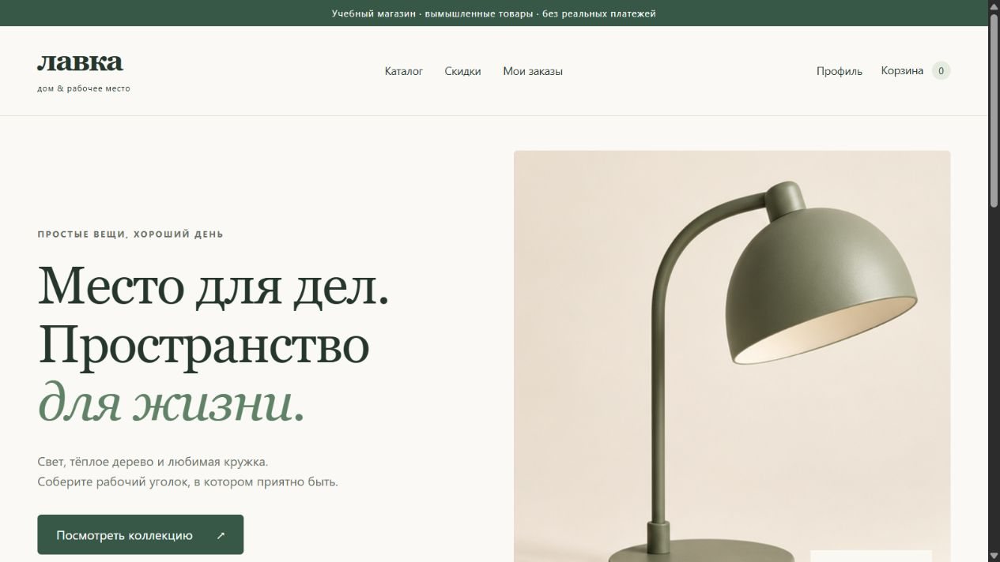
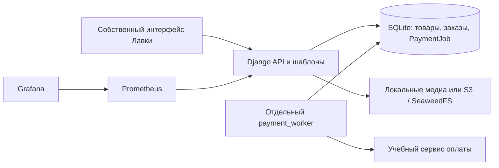

# Лавка — интернет-магазин на Django

[](https://github.com/Sarmagon/lavka-django/actions/workflows/ci.yml)

Учебный магазин товаров для дома и рабочего места: 12 вымышленных товаров, три категории, два демо-продавца. Backend основан на итоговом проекте курса «Python-фреймворк Django», Skillbox (Megano). Для портфолио создан отдельный интерфейс «Лавка»: собственные шаблоны, CSS и JavaScript, системные шрифты и сгенерированные изображения. Использовалась помощь Codex. Предоставленный учебный frontend в репозиторий не перенесён.

## Демонстрация



[Пример оплаченного учебного заказа](docs/screenshots/order.png). Локально проверены поиск, корзина, регистрация при оформлении, создание заказа и обработка mock-оплаты worker.

## Возможности

- Каталог, поиск, фильтры по категории, цене, производителю и характеристикам; сортировка, страницы, скидки и отзывы.
- Регистрация, вход, профиль, аватар и смена пароля. Корзина хранится в сессии.
- Оформление заказа, доставка, серверный расчёт суммы, резервирование остатков и история заказов.
- Идемпотентное оформление. Учебная оплата через PaymentJob в базе данных и отдельный worker с повторными попытками; Celery и RabbitMQ здесь не используются.
- S3-совместимые медиа через django-storages/SeaweedFS, копирование с проверкой целостности. Prometheus, Grafana и node-exporter; метрики защищены токеном.

**Стек:** Python 3.12–3.14, Django 5.2, SQLite, Poetry, Pillow, django-storages, Sentry SDK, django-prometheus, Docker Compose для инфраструктуры. PostgreSQL не приписывается: текущая БД приложения — SQLite.

## Запуск

Нужны Python 3.12+ и Poetry 2.5.1. Из каталога проекта:

```bash
poetry install --no-root
cp .env.example .env
poetry run python -c "import secrets; print(secrets.token_urlsafe(64))"
```

Сохраните сгенерированный ключ в DJANGO_SECRET_KEY в .env. Для локальной демонстрации используйте DJANGO_DEBUG=1 и DJANGO_ALLOWED_HOSTS=localhost,127.0.0.1.

```bash
poetry run python manage.py migrate
poetry run python manage.py seed_lavka
poetry run python manage.py changepassword admin
poetry run python manage.py runserver 127.0.0.1:8000
```

Откройте http://127.0.0.1:8000/. seed_lavka запускается только на пустом каталоге и отказывается менять существующие товары. Все товары и цены вымышленные. Аккаунт покупателя создаётся через интерфейс; начальный пароль администратора не задан.

Для оплаты запустите ещё два процесса с той же .env:

```bash
poetry run python manage.py mock_payment_service
poetry run python manage.py payment_worker
```

В заказе введите учебный чётный номер 2468 и обновите статус после обработки. Номера настоящих карт не нужны. Без worker задача остаётся в очереди.

## Архитектура



## Проверки и ограничения

```bash
poetry run python manage.py check
poetry run python manage.py makemigrations --check --dry-run
poetry run python manage.py test
git diff --check
```

CI запускает реальные тесты, Django check и проверку моделей на Python 3.12/3.13. Исходная окончательная версия backend проходила 66 тестов; дополнительные проверки Лавки покрывают собственные страницы, изображения, поиск и защиту демо-наполнения. Локально прошли все 72 теста; check и проверка моделей — без ошибок. Актуальный результат смотрите в CI.

Runserver, DEBUG=1 и SQLite — локальная учебная конфигурация. Реальная банковская оплата, публичное production-развёртывание и доставка не реализованы. Интеграция Sentry подготовлена, внешний приём событий не проверен. Перенос медиа и мониторинг проверялись в исходной Ubuntu-версии; новый интерфейс проверяется отдельно. Автоматическая отмена заказа и снятие резерва не реализованы. Не публикуйте .env, базы, загруженные медиа и infra/observability/secrets.

[Мониторинг и S3](docs/operations.md) · [Происхождение интерфейса и изображений](docs/assets.md)

## Происхождение

Backend перенесён из собственной итоговой версии Megano master 08891e9 после MR7/MR8. Новый репозиторий создан из проверенного снимка без старой истории, локальных секретов и предоставленного diploma-frontend. Исходный учебный репозиторий сохранён отдельно. Исторические технические документы содержат прежнее название Megano; имена метрик megano_* сохранены для совместимости с проверенными панелями.
